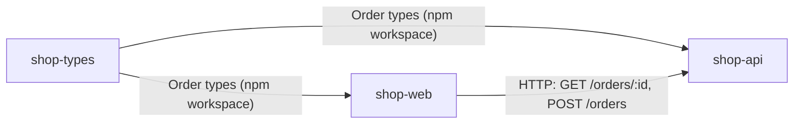

# System map

Three repos make up the shop.

| Repo | Owns |
|------|------|
| shop-types | The shared `Order`, `OrderItem` and `OrderStatus` types [shop-types@SHA_SHOP_TYPES:src/index.ts:1-15] |
| shop-api | The orders HTTP API on port `PORT`, default 4000 [shop-api@SHA_SHOP_API:src/server.ts:8-9] |
| shop-web | The web UI, which reads and creates orders through shop-api [shop-web@SHA_SHOP_WEB:src/api.ts:5-19] |

- shop-api and shop-web both depend on shop-types as a workspace package [shop-api@SHA_SHOP_API:package.json:11] [shop-web@SHA_SHOP_WEB:package.json:11].
- shop-web finds shop-api through `VITE_API_URL`, with `http://localhost:4000` as the fallback [shop-web@SHA_SHOP_WEB:src/api.ts:3].

Contracts: [orders API](contracts/orders-api.md), [order types](contracts/order-types.md).

## Common changes

### Add a field to an order

Make the change in this order: producer first, then consumers.

1. **shop-types:** add the field to `Order` [shop-types@SHA_SHOP_TYPES:src/index.ts:9-15].
2. **shop-api:** set the field where `POST /orders` builds the order object [shop-api@SHA_SHOP_API:src/orders.ts:18-19]. Validate it in the request check if clients send it [shop-api@SHA_SHOP_API:src/orders.ts:15-17].
3. **shop-web:** render it on the order page [shop-web@SHA_SHOP_WEB:src/OrderPage.tsx:15-21]. If clients send it, pass it through `createOrder` too [shop-web@SHA_SHOP_WEB:src/api.ts:11-16].

**Traps:**
- shop-api builds `Order` as an object literal, so a new **required** field fails type-checking until step 2 is done [shop-api@SHA_SHOP_API:src/orders.ts:19].
- Orders live only in memory, so there's no old data to backfill. That changes if a database is added (see `gaps.md`) [shop-api@SHA_SHOP_API:src/orders.ts:4].
