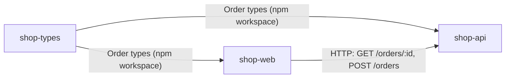

# System map

Three repos make up the shop.

| Repo | Owns |
|------|------|
| shop-types | The shared `Order`, `OrderItem` and `OrderStatus` types [shop-types@SHA_SHOP_TYPES:src/index.ts:1-15] |
| shop-api | The orders HTTP API on port `PORT`, default 4000 [shop-api@SHA_SHOP_API:src/server.ts:8-9] |
| shop-web | The web UI, which reads and creates orders through shop-api [shop-web@SHA_SHOP_WEB:src/api.ts:5-19] |

- shop-api and shop-web both depend on shop-types as a workspace package [shop-api@SHA_SHOP_API:package.json:11] [shop-web@SHA_SHOP_WEB:package.json:11].
- shop-web finds shop-api through `VITE_API_URL`, with `http://localhost:4000` as the fallback [shop-web@SHA_SHOP_WEB:src/api.ts:3].

Contracts: [orders API](contracts/orders-api.md), [order types](contracts/order-types.md).
